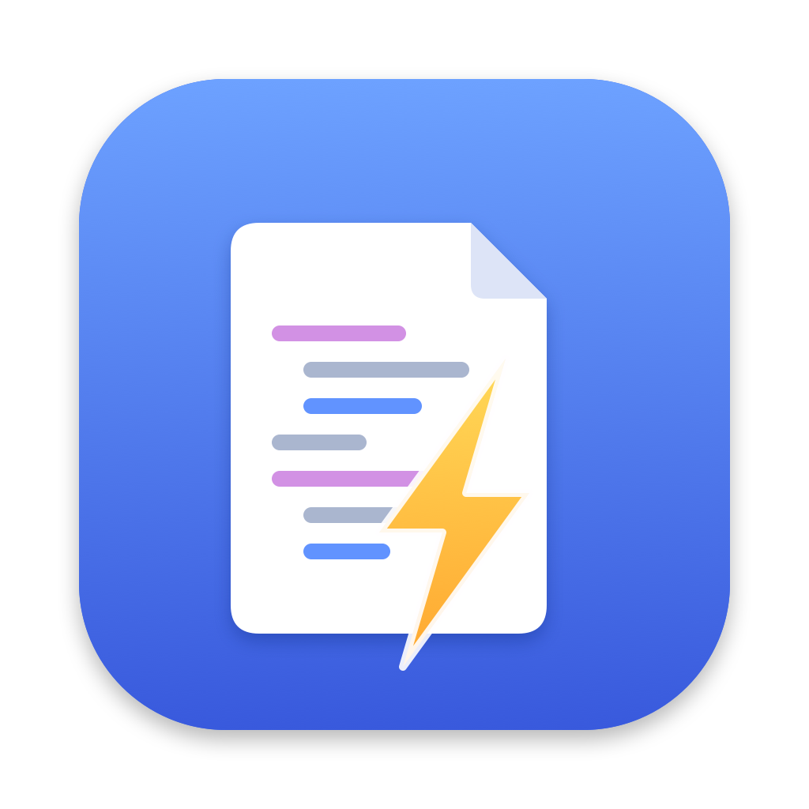
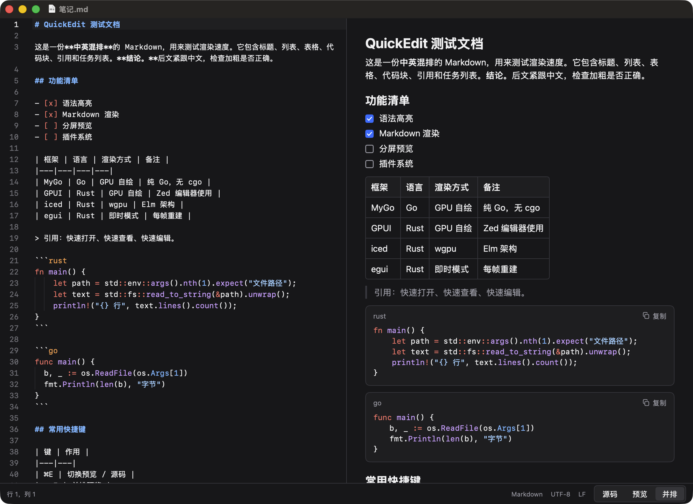
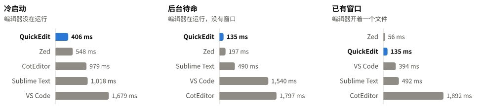
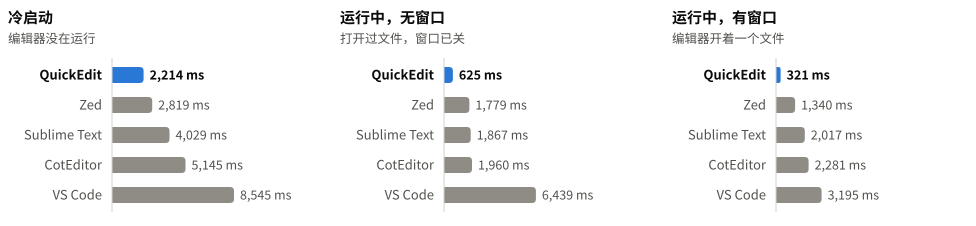
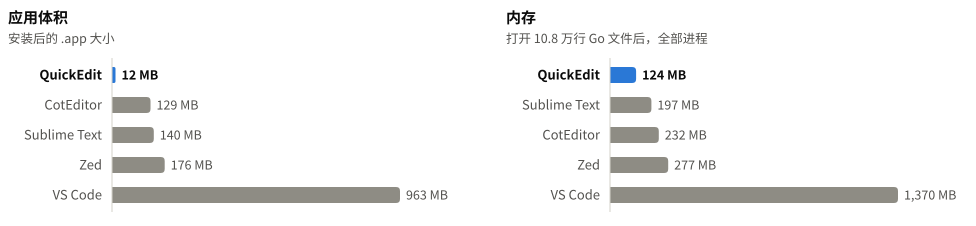
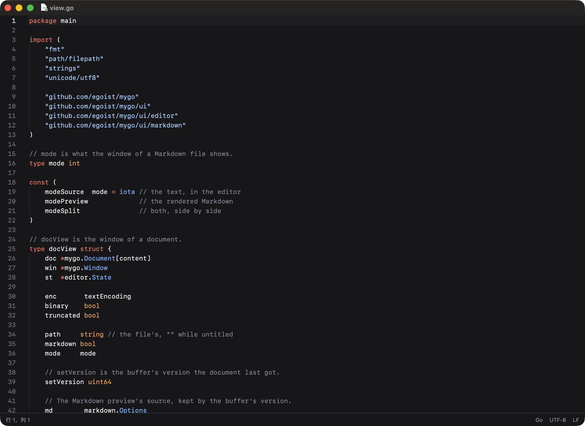

<p align="center">
  
</p>

<h1 align="center">QuickEdit</h1>

<p align="center">
  <b>极致快速的轻量编辑器，为灵活编辑而生。</b><br>
  双击文件，0.1 秒级打开。看代码、改配置、读 Markdown、翻日志：打开就用，用完就走。
</p>

<p align="center">
  <a href="https://github.com/kadaliao/quickedit/releases/latest">下载</a> ·
  <code>brew install --cask kadaliao/tap/quickedit</code> ·
  macOS 13+，Apple 芯片
</p>

<p align="center">
  
</p>

## 为什么快

- **后台待命，双击即开**：登录时在后台启动、不开窗口，关掉最后一个窗口也不退出，还总备着一个隐藏窗口。
  双击文件时只需把内容放进窗口：10.8 万行的 Go 文件 135 毫秒显示完毕。不想要可以在应用菜单里关掉。
- **冷启动也快**：没在运行时打开同一个文件 406 毫秒，比 Zed、Sublime Text、VS Code 都快。
- **文件再大也不拖慢**：只排版看得见的行，60 万行、44 MB 的日志 0.3 秒打开。
- **轻**：原生 GPU 绘制（[MyGo](https://github.com/egoist/mygo)），没有 Electron，没有 WebView。
  应用 12 MB，后台待命时占约 45 MB 内存。
- **命令行直达**：`qe` 经本地 socket 把文件直接交给后台的 QuickEdit，不经过系统转发。

## 速度对比

同一台 Mac（Apple M2，macOS 26），各编辑器在**同样的状态**下打开同样的文件。计时从请求打开（与在 Finder 里双击走同一条路），
到内容（含语法高亮、Markdown 渲染）显示稳定、窗口到了最前面为止，越短越好。

**打开 10.8 万行的 Go 文件（3.1 MB）**

<picture>
  <source media="(prefers-color-scheme: dark)" srcset="docs/images/bench-bigfile-dark.svg">
  
</picture>

- 冷启动和后台待命，QuickEdit 都最快。
- 编辑器已经开着窗口时，Zed 把新文件开成标签页，56 毫秒，最快。QuickEdit 每个文件开一个新窗口，135 毫秒，排第二。

**各种文件**（各编辑器都在后台待命、没有窗口）

<picture>
  <source media="(prefers-color-scheme: dark)" srcset="docs/images/bench-files-dark.svg">
  
</picture>

大文件和 Markdown，QuickEdit 最快。1,300 行的小文件，Sublime Text 快 21 毫秒；44 MB 的日志，Zed 快 70 毫秒。
四个文件加起来 QuickEdit 用时最短：721 毫秒，第二的 Zed 是 855 毫秒。

**体积和内存**

<picture>
  <source media="(prefers-color-scheme: dark)" srcset="docs/images/bench-footprint-dark.svg">
  
</picture>

<details>
<summary>全部数据（毫秒，粗体为每行最快）</summary>

文件：`small.go` 为 1,300 行的 Go 源码；`big.go` 为 10.8 万行、3.1 MB 的 Go 源码；`doc.md` 为 1,332 行中英混排的 Markdown；
`huge.log` 为 60 万行、44 MB 的日志。

**冷启动**：编辑器没在运行。5 次中位数。

|  | QuickEdit | Sublime Text | Zed | CotEditor | VS Code |
|---|---:|---:|---:|---:|---:|
| small.go | **403** | 558 | 635 | 944 | 1,573 |
| big.go | **406** | 1,018 | 548 | 979 | 1,679 |
| doc.md | **476** | 598 | 560 | 898 | 1,837 |
| huge.log | **531** | 1,699 | 620 | 1,391 | 1,905 |

**后台待命**：编辑器在运行，没有窗口。3 次中位数。

|  | QuickEdit | Sublime Text | Zed | CotEditor | VS Code |
|---|---:|---:|---:|---:|---:|
| small.go | 135 | **114** | 202 | 304 | 1,326 |
| big.go | **135** | 490 | 197 | 1,797 | 1,540 |
| doc.md | **137** | 196 | 212 | 379 | 1,848 |
| huge.log | 314 | 1,211 | **244** | 803 | 1,890 |

**已有窗口**：编辑器开着一个文件，再打开另一个。5 次中位数。

|  | QuickEdit | Sublime Text | Zed | CotEditor | VS Code |
|---|---:|---:|---:|---:|---:|
| small.go | 130 | 120 | **53** | 352 | 246 |
| big.go | 135 | 492 | **56** | 1,892 | 394 |
| doc.md | 168 | 161 | **52** | 361 | 417 |
| huge.log | 251 | 1,202 | **57** | 838 | 925 |

Sublime Text、Zed、VS Code 在原窗口里开标签页，CotEditor、QuickEdit 每个文件开一个新窗口。

</details>

为了公平：测试期间关掉系统的窗口打开动画；每个编辑器都关掉恢复上次窗口的功能；VS Code 用临时数据目录、不装扩展；
每个编辑器先启动一次不计时；后台待命时，每个编辑器（包括 QuickEdit）都先打开一个文件、再关掉窗口。
版本：Sublime Text 4（build 4215）、CotEditor 7.1.3、Zed 1.27.0、VS Code 1.145.2。
测法、脚本和原始数据见 [bench/compare/](bench/compare/)。

## 按文件自适应

<p align="center">
  
</p>

- **代码**按语言高亮，30 多种语言；没有扩展名的脚本按 `#!` 行识别。
- **Markdown** 默认显示渲染结果，可以切到源码或并排显示。
- **二进制文件**以十六进制只读显示。
- **编码**：自动识别 UTF-8、UTF-8 BOM、UTF-16、GBK/GB18030，保存时按原编码、原换行符写回。
- **像 Mac 应用一样保存**：自动保存、崩溃后恢复、外部修改提示，文件菜单有复制、重命名、移动、还原。
- 界面跟随系统的深浅色和语言（简体中文 / 英文）。

## 安装

**Homebrew**（同时装好 `qe` 命令）：

```sh
brew install --cask kadaliao/tap/quickedit
```

**手动**：从 [Releases](https://github.com/kadaliao/quickedit/releases/latest) 下载 DMG，把 QuickEdit 拖进「应用程序」。
应用只做了 ad-hoc 签名，没有经过 Apple 公证：第一次打开如果被拦，到「系统设置 › 隐私与安全性」点「仍要打开」，
或者运行 `xattr -dr com.apple.quarantine /Applications/QuickEdit.app`。要用 `qe` 命令：

```sh
sudo mkdir -p /usr/local/bin
sudo ln -sf /Applications/QuickEdit.app/Contents/Resources/qe /usr/local/bin/qe
```

第一次从「应用程序」打开时，QuickEdit 会把自己加入登录项，以后登录时在后台待命（macOS 会提示"已添加后台项目"）。
不想要的话，在 QuickEdit 菜单里取消勾选"登录时在后台启动"。

## 快捷键

| 键 | 作用 |
|---|---|
| ⌘N / ⌘O / ⌘S | 新建 / 打开（任何文件）/ 保存 |
| ⌘E | Markdown：切换预览 / 源码 |
| ⌥⌘E | Markdown：并排预览 |
| ⌥Z | 自动换行 |
| ⌘= / ⌘- / ⌘0 | 放大 / 缩小 / 实际大小 |
| ⌘F / ⌥⌘F / ⌃G | 查找 / 替换 / 跳到行 |
| ⌘D / ⇧⌘L | 选中下一个相同内容 / 全部（多光标） |
| ⌘/ | 注释 |
| ⌥↑ / ⌥↓ | 上下移动行 |

编辑键位与 Zed 相同，完整列表见 MyGo 的[代码编辑器文档](https://github.com/egoist/mygo/blob/main/docs/ui/code-editor.md#editing)。

## 命令行

`qe` 的用法和 `subl`、`code` 一样：

```sh
qe notes.md main.go     # 打开文件，不存在的先建空文件
git diff | qe -         # 打开命令的输出
```

QuickEdit 在后台运行时，`qe` 经本地 socket 把文件交给它，比双击再快约 20 毫秒；没在运行时就用 `open` 启动它。

## 构建

需要 Go 1.27.3+ 和 Xcode 命令行工具。

```sh
make build     # build/darwin-arm64/QuickEdit.app
make test
make dmg       # 安装包
make install   # 复制到 /Applications，qe 装到 ~/.local/bin
```

QuickEdit 用的是打了补丁的 MyGo：`scripts/patch-mygo.sh` 把 MyGo v0.8.3 复制到 `.mygo/`，
应用 `patches/mygo/` 下的补丁，`go.mod` 用 `replace` 指向它（`make` 会自动做这一步）。
目前只有一个补丁：中文标点单独测量时会被排成半宽，导致中文行自动换行时超出窗口
（`cjk-wrap.patch`）。上游修复后可以去掉。

框架选型时的对比测试在 [bench/](bench/)：同一个"打开文件"的小程序分别用 MyGo、GPUI、iced、egui 和原生 AppKit 实现，
结果见 [bench/RESULTS.md](bench/RESULTS.md)。

## 许可证

[MIT](LICENSE)
